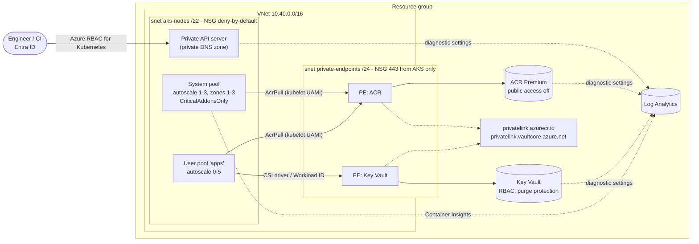
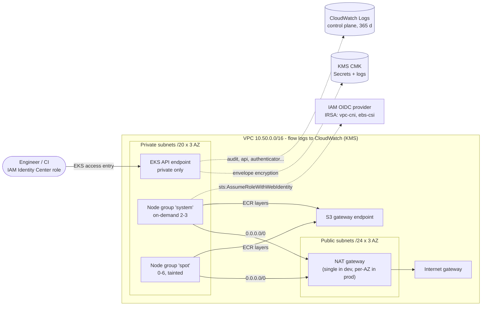

# terraform-cloud-blueprints

[](https://github.com/bhavishyajain545/terraform-cloud-blueprints/actions/workflows/ci.yml)
[](LICENSE)


Production-minded Terraform modules for running Kubernetes on **Azure (AKS)** and **AWS (EKS)**,
plus example environments that compose them. Every resource is written directly against the
`azurerm` / `aws` providers - no community wrapper modules - and every module ships with
`terraform test` suites that run against **mock providers**, so the whole repo is linted,
scanned and tested in CI with **no cloud credentials and zero cost**. Nothing here is ever
applied by CI.

## Why

Cluster modules tend to be either thin demos or 3,000-line abstractions. These blueprints aim
for the middle: the settings a platform team actually argues about in review (private API
servers, identity instead of secrets, encryption, autoscaling bounds, egress, logging) are
first-class, validated inputs with **secure defaults**, and the behaviour is pinned down by tests.

## Architecture

### Azure - `envs/azure-dev`



Pods use Azure CNI **Overlay** (`10.244.0.0/16`) with the **Cilium** data plane, so the VNet
only spends IPs on nodes. Workloads authenticate to Azure with **Workload ID** (OIDC
federation) - no client secrets in the cluster.

### AWS - `envs/aws-dev`



## Repository layout

| Path | What |
|------|------|
| [`modules/azure-network`](modules/azure-network) | VNet, subnets, one NSG per subnet with deny-all baseline, optional NSG diagnostics |
| [`modules/azure-aks`](modules/azure-aks) | Private AKS, system + user pools with autoscaling, Overlay/Cilium, Workload ID, Policy/Defender toggles, ACR, Key Vault (RBAC), private endpoints, diagnostics |
| [`modules/aws-vpc`](modules/aws-vpc) | Multi-AZ VPC, public/private subnets, NAT `per_az`/`single`/`none`, S3 endpoint, KMS-encrypted flow logs |
| [`modules/aws-eks`](modules/aws-eks) | EKS with KMS Secrets encryption, private endpoint toggle, access entries, IRSA, hardened managed node groups, core add-ons |
| [`envs/azure-dev`](envs/azure-dev), [`envs/aws-dev`](envs/aws-dev) | Example root modules: commented remote-state backend, `terraform.tfvars.example`, composition tests |
| `.github/workflows/ci.yml` | fmt, validate + test matrix, tflint, checkov, terraform-docs drift check, optional Infracost |
| `.pre-commit-config.yaml`, `Makefile` | The same checks locally |

## Modules

Full input/output tables are generated by `terraform-docs` into each module README (CI fails
if they drift). The headline interface:

| Module | Key inputs | Key outputs | Tests |
|--------|-----------|-------------|-------|
| `azure-network` | `address_space`, `subnets` (prefixes, service endpoints, delegation, `security_rules`, `create_nsg`), `diagnostics` | `vnet_id`, `subnet_ids`, `nsg_ids` | 8 |
| `azure-aks` | `vnet_subnet_id`, `private_cluster_enabled`, `system_node_pool` / `user_node_pools` (min/max), `network_plugin_mode`, `network_policy`, `workload_identity_enabled`, `azure_policy_enabled`, `defender_enabled`, `acr`, `key_vault`, `private_endpoints` | `cluster_id`, `oidc_issuer_url`, `kubelet_identity`, `acr_login_server`, `key_vault_uri`, `log_analytics_workspace_id` | 20 |
| `aws-vpc` | `cidr_block`, `azs`, `nat_gateway_mode`, `flow_logs`, subnet CIDRs/tags | `vpc_id`, `private_subnet_ids`, `public_subnet_ids`, `nat_public_ips` | 13 |
| `aws-eks` | `subnet_ids`, `kubernetes_version`, `endpoint_public_access(_cidrs)`, `kms_key_arn`, `access_entries`, `node_groups`, `addons` | `cluster_endpoint`, `oidc_provider_arn`, `kms_key_arn`, `irsa_role_arns`, `node_role_arn` | 16 |
| `envs/*` | - | - | 2 + 2 |

## Usage

Reference a module from your own root module (pin to a tag):

```hcl
module "vpc" {
  source = "git::https://github.com/bhavishyajain545/terraform-cloud-blueprints.git//modules/aws-vpc?ref=v0.1.0"

  name             = "payments-prod"
  cidr_block       = "10.60.0.0/16"
  azs              = ["eu-central-1a", "eu-central-1b", "eu-central-1c"]
  nat_gateway_mode = "per_az"
}
```

Or start from an environment:

```sh
cd envs/aws-dev
cp terraform.tfvars.example terraform.tfvars   # edit placeholders
# configure backend.tf (S3 + lock) or envs/azure-dev/backend.tf (azurerm)
terraform init
terraform plan
```

Remote state examples are in each `backend.tf`, commented out on purpose: an Azure Storage
backend with Entra ID auth (blob-lease locking), and S3 with SSE-KMS plus either S3-native
`use_lockfile` or a DynamoDB lock table.

## Security decisions

| Decision | Where | Why |
|----------|-------|-----|
| API servers private by default; public access only with explicit CIDRs, `0.0.0.0/0` rejected by validation | AKS, EKS | The control plane is the highest-value target; opening it should be a reviewed choice |
| Identity over secrets: Entra ID + Azure RBAC with local accounts disabled; Workload ID; EKS access entries (no `aws-auth`), no implicit creator-admin; IRSA trust pinned to service account **and** audience | AKS, EKS | No long-lived kubeconfig credentials or cloud keys inside the cluster |
| Envelope encryption of Kubernetes Secrets with a rotating CMK; KMS-encrypted control plane and flow logs | EKS, VPC | Etcd snapshots and logs are useless without the key; key policy scoped by encryption context |
| IMDSv2 required with hop limit 1 on nodes; CNI permissions on an IRSA role, not the node | EKS | Pods cannot reach node-role credentials |
| Deny-by-default NSGs (explicit `DenyAllInbound` at 4096) and Internet-to-SSH/RDP rules rejected | Azure network | Azure's implicit `AllowVnetInBound` is otherwise wide open |
| Default security group emptied; no auto-assigned public IPs; default outbound access disabled | VPC, Azure network | Nothing becomes reachable or egresses by accident |
| ACR: admin user + anonymous pull off, export blocked when private; Key Vault: RBAC, purge protection, default-deny firewall; both private-endpoint-only when enabled | AKS | Registry and secrets are not internet-facing |
| Audit logging everywhere: `kube-audit-admin`/`guard` to Log Analytics, all five EKS log types, flow logs (ALL), Key Vault audit | all | Detect and investigate, not just prevent |
| Upgrades on rails: AKS `patch` + `NodeImage` channels in a maintenance window; EKS `STANDARD` support policy | AKS, EKS | Patching happens; no surprise extended-support bills |
| Accepted risks are **inline `#checkov:skip` with a reason** next to the resource (e.g. ACR content trust is deprecated, Free tier in dev) | modules, envs | The justification is reviewed with the code, not hidden in a global ignore list |

## Testing approach - zero cost

| Layer | Tool | What it proves |
|-------|------|----------------|
| Formatting | `terraform fmt -check -recursive` | Consistent style |
| Static validity | `terraform validate` (`-backend=false`) per module and env | Config matches the real provider schemas |
| Behaviour | `terraform test` with `mock_provider` (Terraform >= 1.7) | 61 runs assert real properties: autoscaling bounds, private cluster flag, NSG deny-by-default, Secrets encryption, NAT count per toggle, IRSA trust, tags; `expect_failures` proves the validations reject bad input. Mocked providers return fake values, so `apply`-mode runs work offline too |
| Lint | `tflint` with the `terraform` (all rules), `azurerm` and `aws` rulesets | Provider-specific mistakes, naming, documented variables/outputs, unused declarations |
| Policy | `checkov` | CIS-style misconfigurations; **every** unskipped finding fails CI (open-source Checkov has no severity data, so this is stricter than "fail on HIGH") |
| Docs | `terraform-docs --output-check` | Module READMEs match the code |
| Cost (optional) | Infracost | Runs only if an `INFRACOST_API_KEY` secret exists, otherwise skips with a notice |

Mock providers mean no credentials exist anywhere in the pipeline: there is nothing to leak
and nothing that can accidentally create infrastructure.

Run everything locally:

```sh
make all              # fmt-check, validate, test, lint, checkov, docs-check
pre-commit install    # same checks on every commit
```

## Tool versions

| Tool | Version |
|------|---------|
| Terraform | 1.16.7 (`required_version >= 1.9, < 2.0`; cross-variable validation needs 1.9) |
| hashicorp/azurerm | `~> 5.11` |
| hashicorp/aws | `~> 6.70` |
| TFLint | 0.65.0 (azurerm ruleset 0.33.0, aws ruleset 0.50.0) |
| Checkov | 3.3.30 |
| terraform-docs | 0.24.0 |

GitHub Actions are pinned to commit SHAs.

## License

[MIT](LICENSE)
